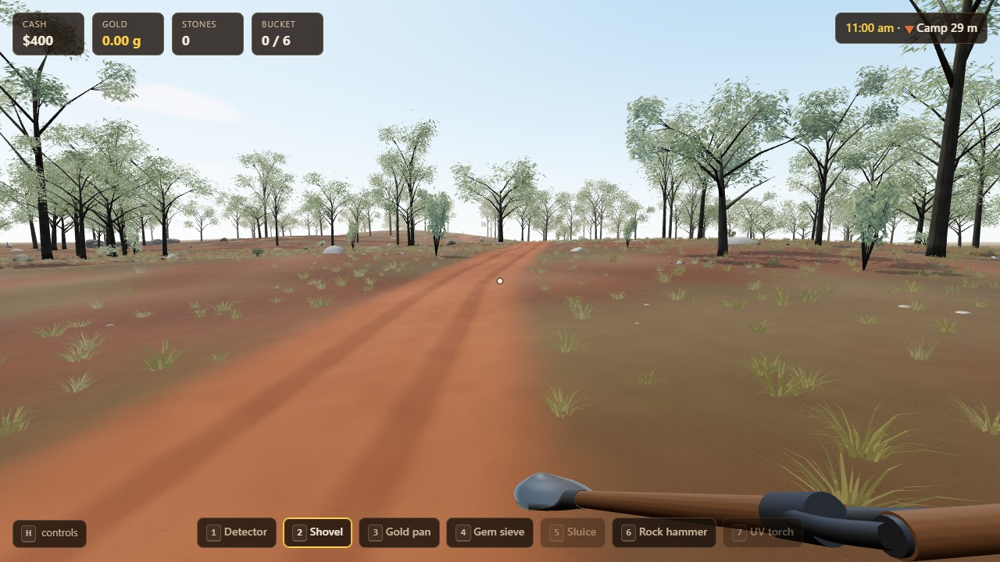
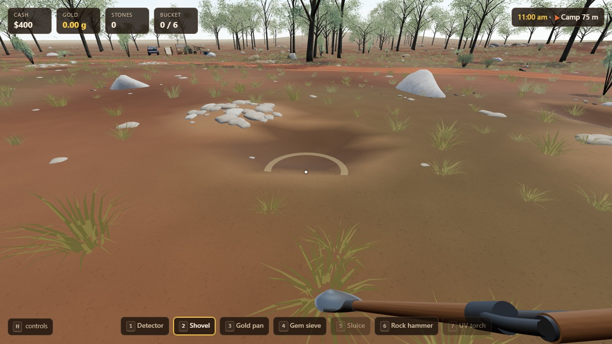
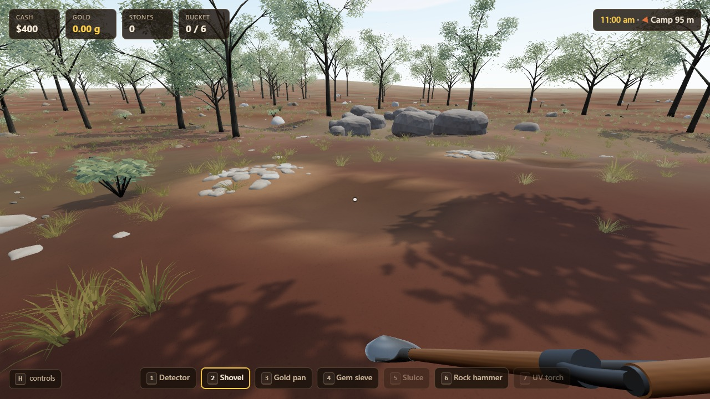
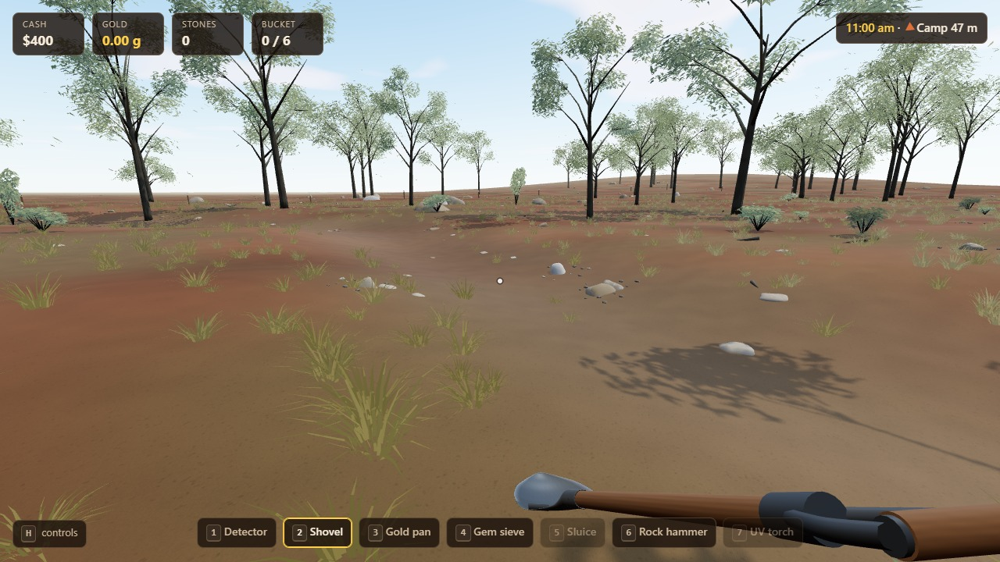
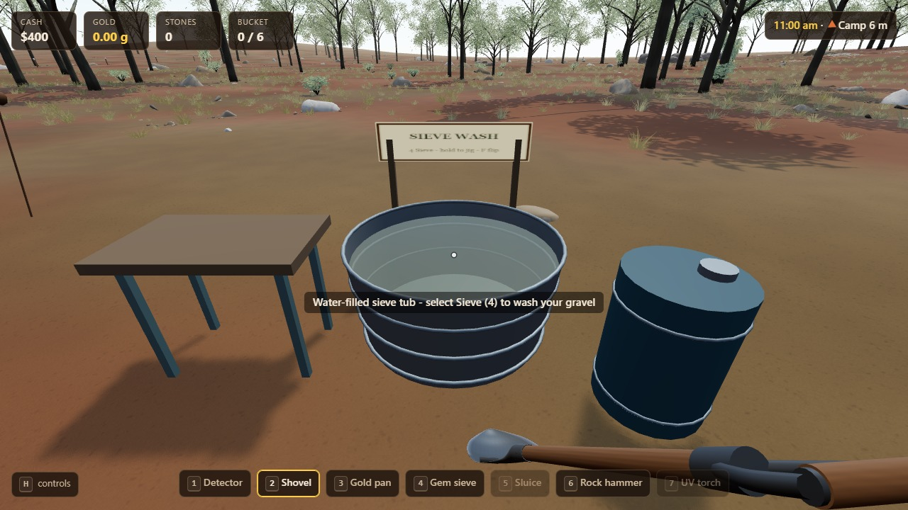
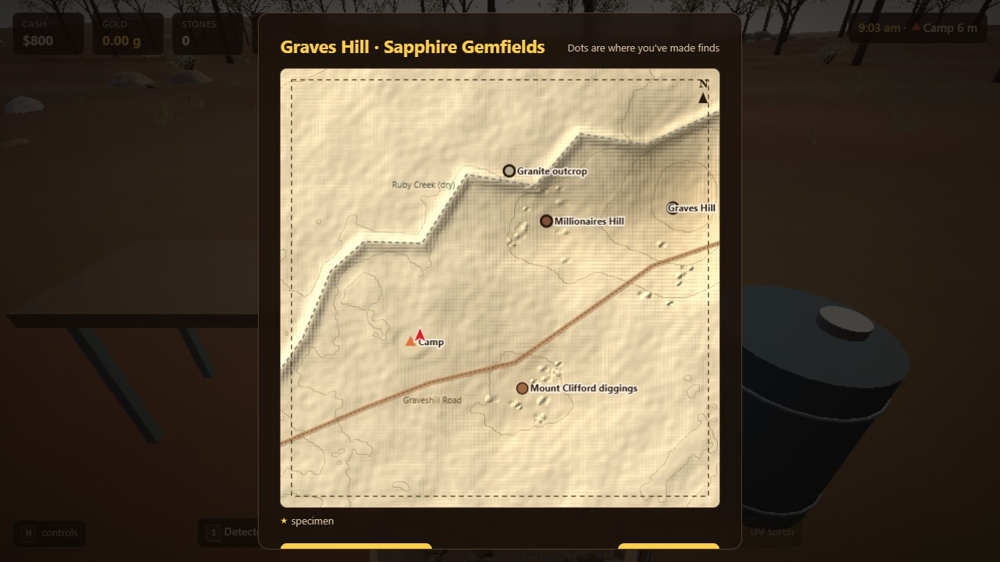

# Graves Hill - implementation and verification

Owner: Codex. Branch `codex/graves-hill`; base `11ced10`; written plan committed first as `88864b5`. Research and acceptance checklist: [GRAVES-HILL-PLAN.md](GRAVES-HILL-PLAN.md).

## What this location represents

A compact playable interpretation of **Graves Hill fossicking area near Sapphire, Queensland**, using the official locality map, government field notes and a photograph actually captioned Graves Hill. The evidence, links and distinctions from adjacent-area photographs are in the plan. This is a deliberately compressed interpretation, not a survey or access guide.

- Southwest-to-northeast red dirt track; Mount Clifford south of Millionaires Hill; Graves Hill northeast; Ruby Creek around the west/north edge. Modest rises, not a generic steep creek valley.
- Mount Clifford has roughly 300-400 mm shallow cover; Millionaires Hill roughly 200-300 mm with darker red/chocolate ground. The eastern former-channel wash is deeper. Original excavations remove cover without simply lowering the whole buried deposit under each pit.
- Mixed billy/silicified-rock and quartz gravel, reject piles, sparse rough-trunked woodland and grassy/bare interspaces. A modest granite exposure is a landmark; sapphire distribution follows wash patches, not an invented granite or basalt source.
- Ruby Creek is represented during a dry visit. Rainfall wets the ground; seasonal creek filling is not simulated in this slice. No imported central permanent stream, quartz reef, agate/crystal-vug attractions or Uralla boulder field.
- Dig/classify samples with the existing shovel, carry them to the water-filled camp tub, and use the original sieve. Realistic retains hold/release jig intensity, loss and flip/recovery. Easy steadies the jig while Use is held; the player flips. The tub/water drum belong to the player's camp. The real site has no public water facilities. Tub water is not depleted; yields and compressed distances remain game approximations.

## Shared foundation and preservation

Original desktop pointer lock, wheel/number keys, touch toolbar, tool/view models, excavation, inventory/recovery, ute, camp progression, difficulty, save transactions and local hillshade/contours are reused. The map adds the actual named workings, track and dry drainage. Labels are constrained to the canvas instead of clipping at the right edge. Travel remains $0.

`graves-hill` has a separate saved world. Billystone (`qld-gemfields`) is still accessible with its unchanged terrain/camp/partial samples. New England's legacy world remains intact. This avoids changing a player's old physical map beneath their saved holes, camp and gear.

Rendering uses the shared regional adapter, instancing, foliage LOD, ground atlas/cut-face shading, weather response and original collider placements. The independent local GLB contains 16 assets / 90,490 triangles / 5,505,004 bytes: four irregular woodland trees, three shrubs and nine closed billy/cobble forms. Remaining geometry comes from the existing NSW kit. The generator adds a `graves-hill` argument; existing NSW/Golden Triangle outputs were not regenerated. No dependencies were added.

## Verification

- `npm ci`, `npm run build`: passed using the lockfile in Codex's worktree.
- `npm test`: **128 tests passed**. Includes three new tests for real locality relationships/shallow and deeper cover, basal concentration and barren ground, three-seed determinism, and independent legacy/new saves. Existing New England byte-identical terrain regression remains passing.
- Exported local kit: **10 additional checks passed** using `tests/newengland-rocks.test.js` with `NSW_KIT_FILE=public/models/graveshill/environment.glb`, `NSW_KIT_MANIFEST=public/models/graveshill/manifest.json`, `ENV_ASSET_COUNT=16`, `ENV_ROCK_COUNT=9`. Every rock is one connected, closed volume with no through-cut.
- `tests/graveshill.game.mjs`: actual mouse/phone shovel input and classification; dry-ground sieve rejection; manual over-jig loss then controlled settling on Realistic; Easy assistance through held touch Use; actual flip consumes one sample; topo map; $0 travel; save/reload and Graves Hill/Billystone/NSW return. Remaining settling is accelerated only after actual input has been verified; this is not a claim that the test plays every full wash.
- `tests/controls.game.mjs` with `CONTROLS_REGION=graves-hill`: genuine browser pointer lock without the test bypass, mouse look, wheel/number keys, movement while switching, map/pause/resume isolation, rejected-lock recovery; original touch pan/menu regression also passed.
- `tests/graveshill.resilience.mjs`: cached production offline reload and map; missing/corrupt local GLB fallback keeps original scenery, identical physical world, targets, finds and working tools. Disposable browser saves only; no user browser storage was cleared.
- `docs/audits/graves-hill/capture.mjs`: player-height views of track, both workings, granite, Ruby Creek, camp and tub on High; Low, Medium, Ultra and landscape touch. Console/shader errors checked. Night and approaching-rain captures supplement the daylight route. Initial thin crowns, uniform ground, unsupported sign and clipped map label were corrected after inspection.

[Gameplay checks](audits/graves-hill/game/checks.json) · [offline/fallback checks](audits/graves-hill/resilience.json) · [visual checks](audits/graves-hill/candidate/checks.json).

## Screenshots

The circle visible when aiming the shovel is the original tool footprint, not a new landmark/helper marker. No permanent world guidance rings were added.

## Performance and limits

One production route, 60 measured seconds after 20 seconds warming up, seed 12345, High, 1920x1080 viewport with 1.5 resolution scale. Windows Chromium 151 / RTX 3090: frame median/p95 **16.7 / 16.7 ms**, CPU callback median/p95 **2.7 / 4.7 ms**, GPU timer median/p95 **5.45 / 7.31 ms**. Median 235 draw calls and 6.43 million triangles including the renderer's passes. [Raw measurements and hardware](audits/graves-hill/production/run-1.json). The final changes after this route were input wording only; the measured environment/geometry is unchanged.

This is a short desktop route, not a full optimisation certification or physical-phone benchmark. Low/Medium reduce foliage/dressing detail while keeping geology, controls and saves. The original NSW finish remains the shared rendering benchmark; user visual acceptance and exact reference-photo parity are not claimed by automated checks. Exact tree species, seasonal hydrology, surveyed scale and a consumable carried-water simulation remain outside this implementation.

## Publication

Implementation **`00c2454f9d6254a8ea82c71515eb1d8129d5d10f`** integrated by fast-forward into clean main and pushed. [Pages run 38911465080](https://github.com/Alvaren/fossicking-game/actions/runs/38911465080) succeeded. Seven published files match the tested production build: both JS chunks, both CSS chunks, NSW and local GLBs byte-for-byte; HTML matches after CRLF/LF normalisation. [Publication evidence](audits/graves-hill/publication.json).

Public High desktop and Medium touch views loaded the local kit successfully with zero console/shader failures. [Public visual checks](audits/graves-hill/public/checks.json) and [public track screenshot](audits/graves-hill/public/high-track.jpg). Visit [the published game](https://alvaren.github.io/fossicking-game/) and choose **Map → Locations & travel → Graves Hill**; travel is $0. Existing worlds remain available. Final documentation/evidence is a follow-up commit with identical gameplay/assets.
