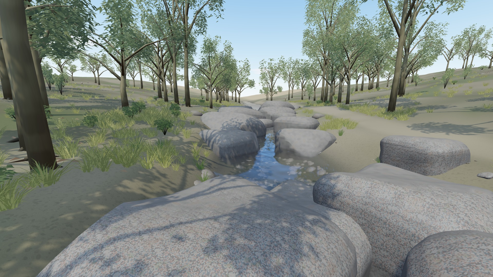
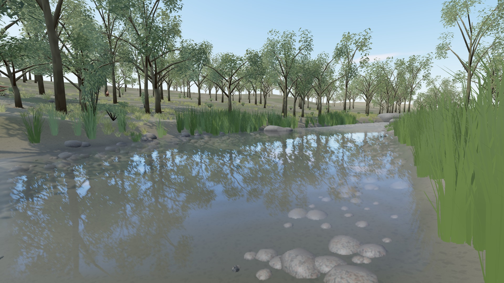
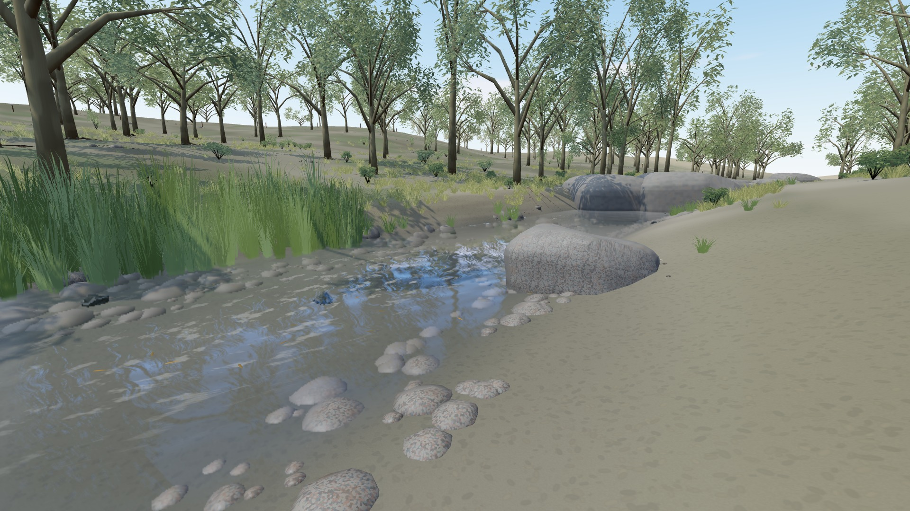
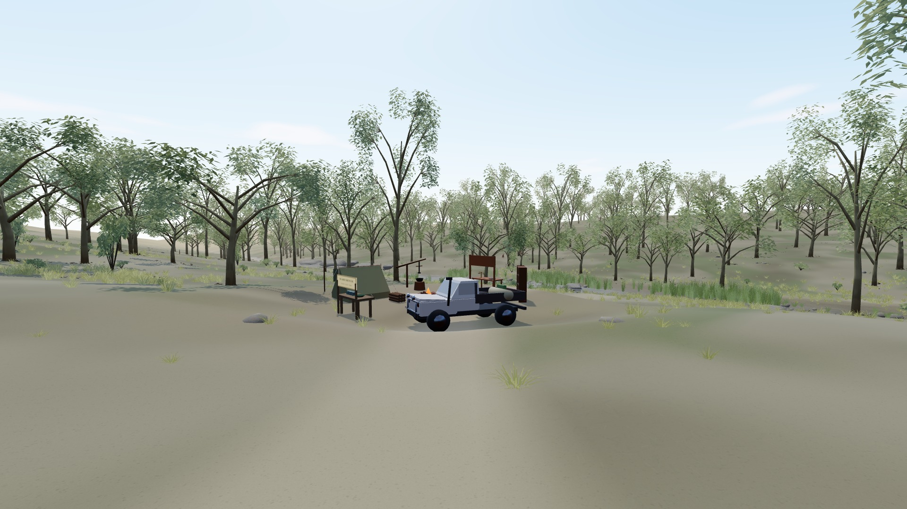
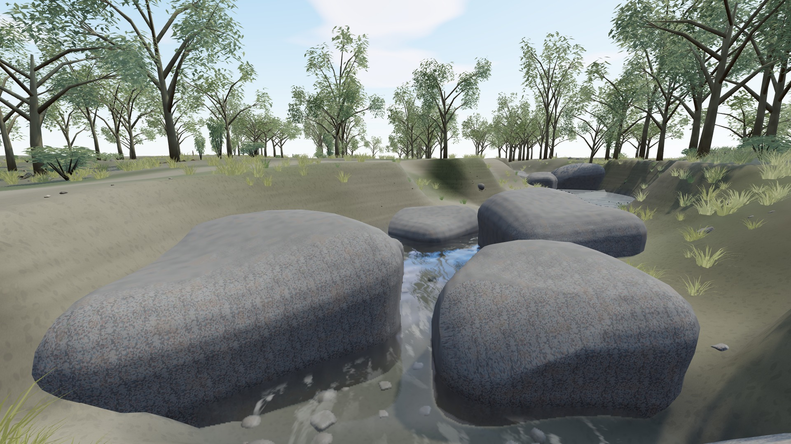
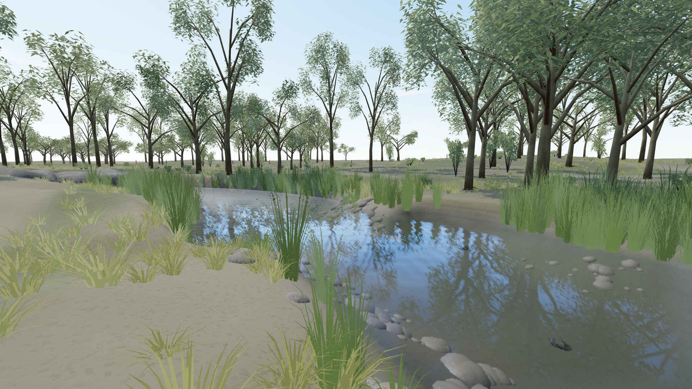
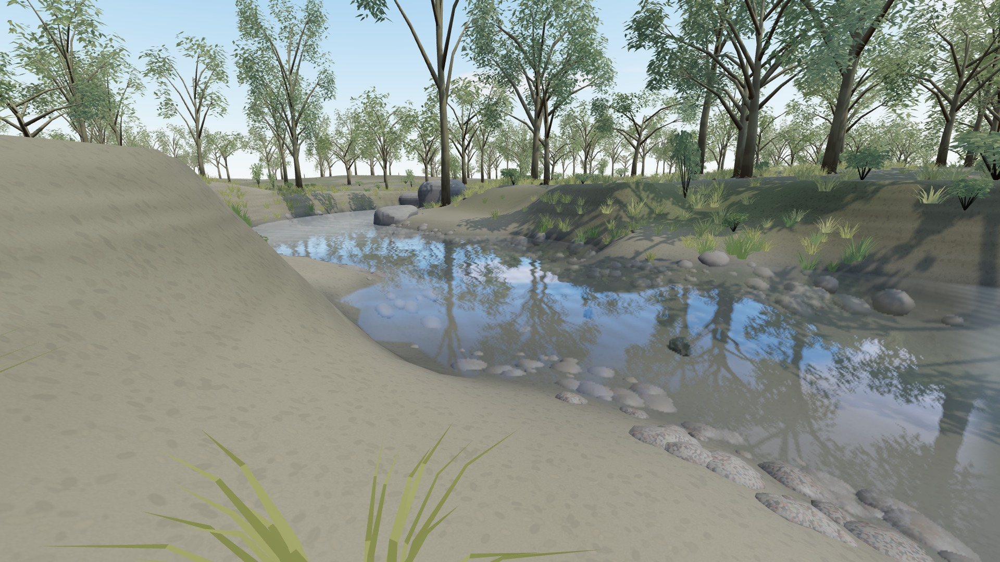
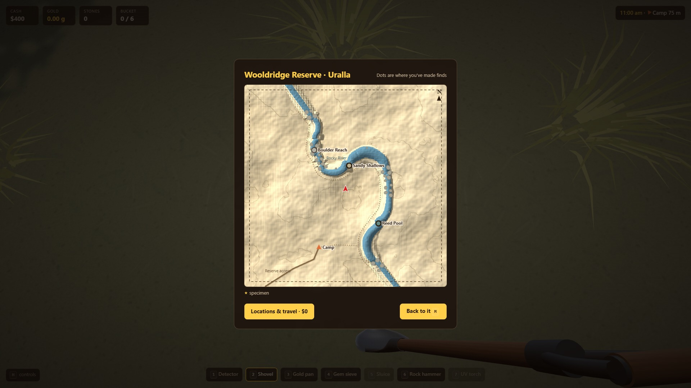

# Uralla / Wooldridge Reserve delivery

The initial delivery below did not reproduce the real river course. The [river correction record](#river-layout-correction--17-october-2026) supersedes its geographic acceptance and screenshots.

17 October 2026. Branch `codex/uralla`, base `dc1fc3d`; research/plan committed first as `369765d`. The [plan and sources](URALLA-PLAN.md) record actual photographs inspected before implementation. No other agent was launched or messaged. Main and Claude were clean at setup; their work is preserved.

## What is built

A separate destination from Map → Locations & travel → Uralla · Wooldridge, with a $0 fee and independent saved terrain, camp, buckets and partly worked pan. Existing New England stays accessible. The shared hillshade and 2-metre contours remain always visible; Uralla adds the access path, Rocky River and descriptive reach names to that same map.

The river has two large granite reaches, a broad quiet pool, open sampling shallows and a bank footpath. The largest stones are roughly 5–7 metres across at game scale, with conservative circular colliders matching the existing movement system. Four local granite variants have rounded rectangular joints, capped weathered outer faces, pale mineral grain and wet lower surfaces. Six cobble variants accompany them. All ten meshes are closed and connected. The local kit contains 22,632 triangles; the ten assets are replacements within the reused 42-asset NSW kit, not 52 independently loaded scene models.

The shared NSW trees, ground atlas, bank roots, meadow composition, light/weather system, ripples, reflections, instancing, distance culling and quality controls are reused. Local additions are tall mixed-height gums, denser grass around boulder reaches, reed beds and sandy access. The original shovel, hand tools, pointer lock, wheel/number keys, touch handlers, excavation, panning and camp interfaces are used directly.

Fine gold and the supported sapphire/garnet mix use the existing depth, hydraulic trap, classification and difficulty calculations. There is no invented reef, crystal pocket or large-nugget field. Your highbanker upgrade remains owned but tool 5 uses the unpowered sluice in this reserve. Deposit constants and all water depths are gameplay interpretations, not measured local yields.

## Checks and evidence

- `npm ci` and production build passed. No dependencies changed.
- 132 logic tests passed, including deterministic Uralla across three seeds, accessible shallow wash, path clearance, fine-gold trapping and separate old/new saves. Existing original-world geometry regression tests passed.
- Local kit: 11 geometry checks passed, including closed/connected surfaces without through-cuts in every rock.
- Desktop and emulated-touch game checks: actual $0 map travel, keyboard movement stopped by a giant boulder on desktop, shovel/classifier loads, mouse pan strokes / visible Easy panning, partly worked pan persistence, wet sieve agitation/flip, and return to the original saved shed/bucket. No JavaScript errors. Relocation skips walking in this fixture; sieve settling is accelerated only after exercising actual Use. [Results](audits/uralla/game/checks.json).
- Real pointer lock without `?test`, mouse look, wheel and number keys, movement while switching, menu isolation, pause/resume and tool close passed for both Uralla and original New England. Original touch toolbar/brief Use/menu recovery passed.
- Three-seed art/quality tests: loading models and switching Low/Medium/High preserve simulation, source rocks, collisions, saves and targets; actual kneeling trowel, saved cuts and reload pass. [Results](audits/uralla/regression.json).
- Offline cached reload and both 404/corrupt Uralla GLB fallback passed with identical world/collider snapshots and functioning tools. [Results](audits/uralla/resilience.json).

A close-up art audit caught Blender material names suffixed with `.001`, which the loader interpreted as slate. The local generator now exports explicit `granite_...` roles; an asset-contract test and an actual loaded-geometry check guard this. No global loader workaround was needed.

The first game fixture attempted to pan from the nearly dry sampling margin and timed out. The corrected fixture steps into the river for washing and passes. No production input workaround was added.

## Visual comparison and remaining limits

The actual council photo sets the boulder scale and rounded rectangular granite silhouette. The visitor pool photo sets the open water, sandy margin and far-bank reeds. Shared mature gums and variable height keep the reserve wooded. These references do not imply a surveyed replica: the river course, paths, reach names, terrain relief and sample positions are compressed interpretations.

The game remains stylised. Crown detail, soil microstructure and repeated procedural rock forms still differ from the source photographs and the earlier six cinematic references. Camp uses the existing progression and props; it is not a reconstruction of every toilet, picnic table or other reserve facility. Camp building upgrades remain game abstractions. No photo textures were redistributed. Physical phone performance is not measured; emulated touch verifies layout and controls only.

## Performance sample

Final build: 20-second warm-up, then one 120-second route through eight views, with an equipped camp and a worked soil patch. High at a 1920×1080 viewport, 1.5 render scale, Windows Chromium / NVIDIA RTX 3090. Frame median/p95/p99: 16.7/16.7/16.8 ms. CPU median/p95: 4.2/9.8 ms. GPU timer median/p95: 6.07/10.19 ms. 0 measured frames exceeded 50 ms. No reported JavaScript/WebGL errors.

This is a short desktop performance sample, not a long thermal soak or a physical-phone benchmark. Presets retain the large boulders and gameplay while reducing vegetation, resolution and water rendering. [Full measurements and hardware](audits/uralla/final-performance/run-1.json).

## Final screenshots

These are actual production-build captures, not generated concept art. The four working views were inspected at Low, Medium, High and Ultra, plus landscape touch, night and rain. No shader failures or wrong granite material roles remain in [the capture report](audits/uralla/final/checks.json). The Sandy Shallows west bank was cleared after the first review found reeds obscuring the work area.

Hero photographs use the existing photo mode's Natural filter with HUD/grid/stamp disabled. Boulder Reach uses its normal free camera 2.4 metres above the player; the pool, shallows and camp use the ordinary viewpoint. Matching HUD captures remain alongside them.

## Integration

Implementation `81ec2c9` was fast-forwarded into main and published by successful [Pages run 38920322805](https://github.com/Alvaren/fossicking-game/actions/runs/38920322805). All seven live files match the tested production build, including the Uralla GLB and shared NSW GLB (HTML line endings normalised): [byte verification](audits/uralla/public.json). The complete disposable desktop/touch travel, collision, loaded granite roles, digging/classification, pan, sieve and save/return checks pass on the public URL: [public gameplay results](audits/uralla/public-game/checks.json).

Main and Claude were clean before integration. Claude has no commits missing from main; only Codex port 5191 was listening. No other checkout's gameplay files were edited directly, no dependencies changed and no user storage was cleared. This final evidence commit changes documentation/results only; the implementation and asset bytes stay fixed.

Touched code: `src/uralla/*`, shared claim/creek/terrain/world/deposit/map/sluice/rendering hooks, and a generic path-distance helper extracted unchanged from Graves Hill. Assets: only `public/models/uralla/*`, with its headless generator branch. Tests: new Uralla logic/asset/game/resilience checks, region entries in the existing control/art suites, and a Uralla route in the existing performance harness. Source references and caveats remain in documentation rather than player screens.

## River-layout correction — 17 October 2026

Branch `codex/uralla-river-layout`, base `28460f8`; correction plan committed first as `91ab59e`. The earlier photographic art references did not justify the invented sinusoidal river. This pass inspected actual NSW aerial pixels and the connected Rocky River HydroLine features 1128552, 1128580 and 1128599 before laying out the replacement. [Source coordinates, metadata, aerial export URL and transform](audits/uralla-river/source.json) make the footprint reproducible. No imagery was redistributed as a game texture.

The north-up course retains the real hooked bend and returning arm, the long southern pool, sandy inside bar and northwest rocky outlet at a uniform 0.48 horizontal scale. Twenty selected source controls are interpolated through the shared Creek. Terrain, map, current, water rendering, wet surfaces, deposits, floating leaves, mobile bedload and flood-stranded sluices use the same along-river coordinate. Current can travel south on the map while still travelling downstream around the hook. Inside bars rise and retain heavier wash; outside banks deepen. Wider/deeper sections slow the nominal current, shallower constrictions accelerate it, and the same solid boulders produce shelter and wakes. These are the existing gameplay relationships applied to the corrected geometry, not a new recovery system.

The bank path follows the returning reach; a separate footpath connects the southwest camp/access track. Uneven boulder clusters occupy rocky transitions, leaving the pool and sandy bar open. Reeds follow the southern pool. The first audit caught radial ridges caused by extending nearest-channel properties into surrounding land. Even nearest-distance height left creases between the two river arms. Surrounding relief now uses continuous world-space terrain, with a local bank transition; a numerical regression checks that the seams do not return.

### Limits and save handling

The vector source declares 20 m planimetric accuracy. Its connected plan shape is evidence; water depths, widths, seasonal levels, individual boulders, terrace heights and camp facilities are authored interpretations checked against the aerial and ground photographs. The slope/discharge/cross-section calculation is a simplified current model, not measured local hydraulics or a full fluid solver. Game reach names are descriptive labels. The game remains stylised and the user's broader art sign-off remains separate.

Uralla layout version 2 preserves cash, gold, camp upgrades, carried parcels, unfinished pan, sluice loads/concentrate, collected IDs and packed ground cuts/patches. Existing excavations stay at their original absolute grid coordinates; their depths are preserved, but the surrounding river terrain changes. The player and ute return to the relocated camp once. An already placed sluice moves onto the new course with its contents intact. Original positions are archived in the save's `layoutMigration`; subsequent reloads do not relocate the player again. Other destinations' saves and terrain remain unchanged.

### Verification

The production build and all 140 logic/asset tests pass without dependency or asset changes. Focused tests check source-coordinate fidelity, the returning downstream direction, inside/outside bank and deposit behavior, pool/constriction speed, common boulder/wake records, path clearance, old-save migration, continuous terraces and downstream sluice stranding.

Actual original desktop/touch handlers exercise map travel, boulder collision, digging/classification, mouse panning / visible Easy technique, partly worked pan reload, wet sieve agitation/flip and independent camp/bucket state. Real desktop pointer lock, look, wheel/number keys, menu isolation and pause/resume pass. Three seeds exercise art loading, quality changes, real kneeling trowel excavation and save/reload. Cached offline reload plus missing/corrupt local GLB fallback pass. Evidence is in [game checks](audits/uralla-river/game/checks.json), [quality/ground checks](audits/uralla-river/regression.json), [controls log](audits/uralla-river/browser-checks.txt), and [resilience results](audits/uralla-river/resilience.json).

A disposable save made by the pre-correction public build preserves worked ground, partial recovery, camp and funds through migration. New England and Golden Triangle terrain, geology, source records, rocks, colliders, mobile bedload and finds match the pre-correction public build exactly. [Comparison and migration results](audits/uralla-river/regression-migration.json). Browser fixtures use isolated storage; the user's saves were not cleared. Test relocation skips walking only; it does not replace the shared tool input.

### Corrected screenshots and performance

[Capture report](audits/uralla-river/final/checks.json). These are actual production-build captures using the existing photo mode's Natural filter without HUD/grid/stamp. The boulder-water camera is lifted 2.4 metres. The overhead audit alone moves beyond the normal photo range to inspect plan geometry; it is not a player viewpoint. The topographic map is captured through its normal UI.

Final performance sample: one 120-second eight-view route after 20 seconds of warm-up, with a built camp and worked ground. High, 1920×1080 viewport, 1.5 render scale, Windows Chromium / RTX 3090. Frame median/p95/p99: 16.7/16.7/16.8 ms; CPU median/p95: 5.1/10.1 ms; GPU timer median/p95: 5.30/8.19 ms. No measured frames exceeded 50 ms and no JavaScript/WebGL errors were reported. [Measurements and hardware](audits/uralla-river/performance/run-1.json). This is a short desktop sample, not a physical-phone or thermal-soak measurement. Low/touch and rain views are recorded separately in [condition captures](audits/uralla-river/conditions/checks.json).

The corrected implementation is ready for the standing-authorised main integration. Publication evidence follows once Pages and public gameplay are verified.
